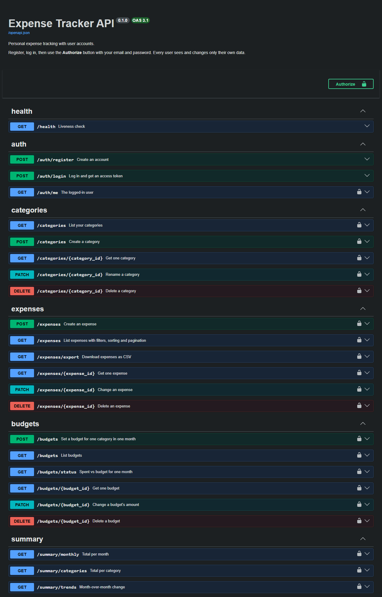
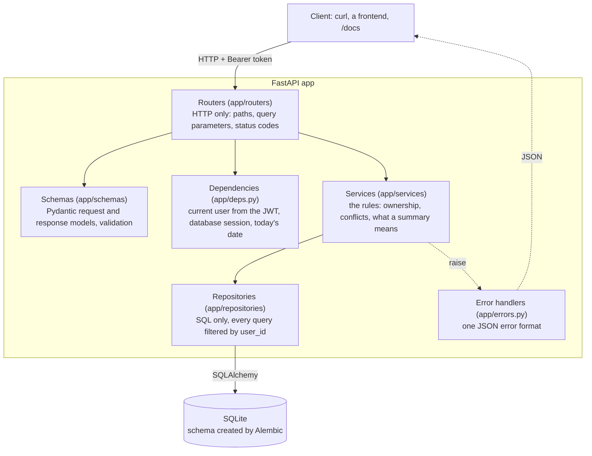
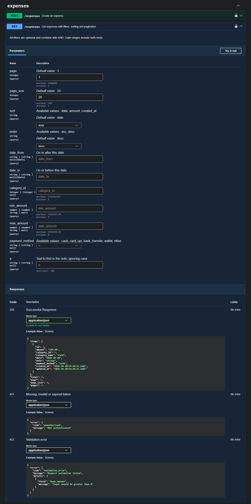

# expense-tracker-api

[](https://github.com/Omkar210404/Expense-Tracker-API/actions/workflows/tests.yml)

A FastAPI backend for personal expense tracking with user accounts. Each user records expenses, sets a monthly budget per category, and reads back summaries of their own spending. Data is stored in SQLite by default.



Everything shown in this README is real. The curl responses are copied from [examples/curl_examples.md](examples/curl_examples.md), which `scripts/capture_examples.py` produced by running `curl` against a running instance. The screenshots are of that same instance. The data in them is **synthetic**: the account is `demo@example.com` and the expenses are made up.

## The problem

Tracking spending in a spreadsheet works until you want to ask it questions: how much went on food this month, am I over the transport budget, is this month higher than last month. Answering those means writing formulas, and sharing the sheet means sharing every row.

This project is the backend for a tracker that answers those questions directly. It keeps each user's data separate behind a login, validates what goes in, and exposes the answers as JSON so any client (a web page, a mobile app, a script) can use them. It is a backend only. There is no frontend.

## What it does

- **Accounts**: register and log in. Passwords are hashed with bcrypt. Login returns a JWT access token.
- **Isolation**: every user sees and changes only their own data.
- **Expenses**: create, read, update, delete. Each has an amount, category, date, note and payment method.
- **Categories**: create, rename, delete. A new account starts with nine defaults.
- **Filters and pagination** on the expense list: date range, category, minimum and maximum amount, payment method, text search in the note, sorting.
- **Budgets**: one amount per category per month, and a report of spent vs budget.
- **Summaries**: total per month, total per category, and month-over-month change.
- **CSV export** of expenses, with the same filters as the list.

## Architecture

Three layers. Each one calls only the layer below it.



- A **router** function reads the request, calls one service function and returns its result. It contains no rules and no SQL.
- A **service** function decides what is allowed. It raises `NotFoundError`, `ConflictError` or `InvalidInputError`, never an HTTP response.
- A **repository** function runs one query. Every function that touches a user's data takes `user_id` and filters on it. No function looks a row up by its id alone.
- **Configuration** comes from environment variables only ([app/config.py](app/config.py)).

### Project layout

```
app/
  main.py            application factory: routers, error handlers, /docs
  config.py          settings read from the environment
  database.py        engine, session factory, declarative base
  models.py          SQLAlchemy models: User, Category, Expense, Budget
  security.py        bcrypt password hashing, JWT create and decode
  deps.py            current user, database session, today's date
  errors.py          error classes and the JSON error handlers
  money.py           decimal <-> integer minor units
  months.py          calendar-month arithmetic
  schemas/           Pydantic models
  routers/           auth, categories, expenses, budgets, summary, health
  services/          auth, categories, expenses, budgets, summaries, export
  repositories/      users, categories, expenses, budgets
alembic/             migration environment and versions/0001_initial_schema.py
tests/               pytest suite
scripts/             capture_examples.py
examples/            curl_examples.md, captured from a real run
docs/                screenshots
```

### Data model

| Table | Columns | Rules |
|-------|---------|-------|
| `users` | id, email, hashed_password, created_at | email unique, stored lower-case |
| `categories` | id, user_id, name, name_key, is_default, created_at | name unique per user ignoring case; deleted with the user |
| `expenses` | id, user_id, category_id, amount_minor, date, note, payment_method, created_at, updated_at | amount above zero; payment method from a fixed list; a category in use cannot be deleted |
| `budgets` | id, user_id, category_id, month, amount_minor | one per user, category and month; deleted with the category |

Money is stored as whole minor units in an integer column (`249.50` is stored as `24950`). SQLite has no decimal type, so a decimal column would be stored as a float and sums would pick up rounding errors. The API accepts an amount as a number or a string with at most two decimal places and returns it as a string with exactly two (`"249.50"`). There is one currency and no currency field.

The schema is created by an Alembic migration. The app never creates tables itself: if they are missing it stops at startup and tells you to run `alembic upgrade head`.

## Install and run

Needs Python 3.11 or newer.

```bash
git clone https://github.com/Omkar210404/Expense-Tracker-API.git
cd Expense-Tracker-API
python -m venv .venv
```

Activate the environment:

```powershell
.venv\Scripts\Activate.ps1      # Windows PowerShell
```

```bash
source .venv/bin/activate       # macOS / Linux
```

Install:

```bash
pip install -r requirements-dev.txt
```

`requirements.txt` holds the runtime packages. `requirements-dev.txt` adds pytest and the HTTP client the tests use.

### Configure

Configuration comes from environment variables. For local use, copy `.env.example` to `.env` (git-ignored) and set `JWT_SECRET`:

```bash
cp .env.example .env            # Windows: copy .env.example .env
python -c "import secrets; print(secrets.token_urlsafe(48))"
```

Paste the printed value after `JWT_SECRET=` in `.env`.

| Variable | Required | Default | Purpose |
|----------|----------|---------|---------|
| `JWT_SECRET` | yes | none | key that signs the access tokens, at least 32 characters |
| `DATABASE_URL` | no | `sqlite:///./expenses.db` | SQLAlchemy database URL |
| `ACCESS_TOKEN_EXPIRE_MINUTES` | no | `30` | lifetime of an access token |
| `BCRYPT_ROUNDS` | no | `12` | bcrypt cost factor, 4 to 16 |
| `CORS_ORIGINS` | no | empty (CORS off) | comma-separated origins allowed to call the API from a browser |

The secret has no default anywhere in the code. Without it the app does not start:

```text
app.config.ConfigError: Invalid configuration (JWT_SECRET: Field required). See .env.example for the variables to set.
```

### Create the database and start

```bash
alembic upgrade head
uvicorn app.main:app
```

The API is at `http://127.0.0.1:8000`. Interactive documentation is at `/docs`, and the OpenAPI schema at `/openapi.json`.

### Docker

```bash
cp .env.example .env            # then set JWT_SECRET in it, as above
docker compose up --build
```

The container runs the migration and then the server on port 8000, as a non-root user. The SQLite file lives in a named volume (`expense-data`), so it survives a rebuild. `docker compose` stops with a message if `JWT_SECRET` is not set.

**The Docker steps were not run on the machine this was developed on**, because Docker is not installed there. They are checked by the `docker` job in the [GitHub Actions workflow](.github/workflows/tests.yml) instead, which builds the image, starts it with compose, registers and logs in with curl, and confirms the data is still there in a new container. The badge at the top shows whether the latest run of that workflow passed.

## Endpoints

All endpoints except the first three need the header `Authorization: Bearer <token>`.

| Method | Path | What it does | Success |
|--------|------|--------------|---------|
| GET | `/health` | Liveness check | 200 |
| POST | `/auth/register` | Create an account and its default categories | 201 |
| POST | `/auth/login` | Log in with the OAuth2 password form, get an access token | 200 |
| GET | `/auth/me` | The logged-in user | 200 |
| GET | `/categories` | List your categories | 200 |
| POST | `/categories` | Create a category | 201 |
| GET | `/categories/{id}` | Get one category | 200 |
| PATCH | `/categories/{id}` | Rename a category | 200 |
| DELETE | `/categories/{id}` | Delete a category. Refused while expenses use it | 204 |
| POST | `/expenses` | Create an expense | 201 |
| GET | `/expenses` | List expenses with filters, sorting and pagination | 200 |
| GET | `/expenses/export` | Download expenses as CSV, same filters as the list | 200 |
| GET | `/expenses/{id}` | Get one expense | 200 |
| PATCH | `/expenses/{id}` | Change an expense. Send only the fields to change | 200 |
| DELETE | `/expenses/{id}` | Delete an expense | 204 |
| POST | `/budgets` | Set a budget for one category in one month | 201 |
| GET | `/budgets` | List budgets, optionally for one `month` | 200 |
| GET | `/budgets/status` | Spent vs budget for one `month` | 200 |
| GET | `/budgets/{id}` | Get one budget | 200 |
| PATCH | `/budgets/{id}` | Change a budget's amount | 200 |
| DELETE | `/budgets/{id}` | Delete a budget | 204 |
| GET | `/summary/monthly` | Total and count per month | 200 |
| GET | `/summary/categories` | Total, count and share per category | 200 |
| GET | `/summary/trends` | Month-over-month change | 200 |

### Query parameters for `GET /expenses` and `GET /expenses/export`

| Parameter | Meaning |
|-----------|---------|
| `date_from`, `date_to` | Date range, both ends included |
| `category_id` | Only this category |
| `min_amount`, `max_amount` | Amount range, both ends included |
| `payment_method` | `cash`, `card`, `upi`, `bank_transfer`, `wallet` or `other` |
| `q` | Text to find in the note, ignoring case |
| `page`, `page_size` | List only. Page number from 1, and 1 to 100 per page (default 20) |
| `sort`, `order` | List only. `date` (default), `amount` or `created_at`; `desc` (default) or `asc` |

Filters combine with AND. The export returns every match, oldest first.

### Validation

- **Amount**: above zero, at most two decimal places, at most 9,999,999.99.
- **Date**: a real calendar date, not before 2000-01-01, and not more than one day after today. The one-day margin is for users whose local date is already ahead of the server's UTC date.
- **Month**: `YYYY-MM`, year 2000 to 2100.
- **Payment method**: one of the six values above.
- **Note**: up to 500 characters. **Category name**: 1 to 50 characters, unique per user ignoring case.
- **Email**: valid format. **Password**: at least 8 characters and at most 72 bytes. 72 is where bcrypt stops reading, so a longer password is refused instead of being cut short without notice.

### What the summaries mean

- **`/summary/monthly`** takes optional `from` and `to` months (`YYYY-MM`). A bound that is not given defaults to the month of your first or last expense. Months inside the range with no expenses are returned with a zero total, so the series has no gaps.
- **`/summary/categories`** takes optional `date_from` and `date_to`. `share` is the category's total as a percentage of the overall total, to one decimal. Categories with no expenses in the range are left out.
- **`/summary/trends`** takes `months` (1 to 36, default 6) and covers that many calendar months ending with the current one. `change` is the month's total minus the previous month's. `change_percent` is that change as a percentage of the previous month's total, and `null` when the previous month is zero. `average_monthly_total` is the window's total divided by the number of months. This is arithmetic on past months. Nothing is forecast.
- **`/budgets/status`** counts only expenses dated inside the month. `percent_used` is spent divided by budget. `over_budget` is true only when spent is greater than the budget, not when it is equal. Spending in a category with no budget that month is listed under `unbudgeted`, so nothing is hidden.

### Errors

Every error has the same JSON body, whether it comes from this code, from request validation or from an unknown route:

```json
{"error": {"code": "validation_error", "message": "Request validation failed", "details": [{"field": "body.amount", "message": "Input should be greater than 0"}]}}
```

`details` is present only for validation errors.

| Status | `code` | When |
|--------|--------|------|
| 401 | `unauthorized` | No token, an invalid or expired token, or a wrong email or password |
| 404 | `not_found` | Unknown id, **or an id that belongs to another user**, or an unknown route |
| 405 | `method_not_allowed` | The path exists but not with that method |
| 409 | `conflict` | Email already registered, duplicate category name, duplicate budget, category still in use |
| 422 | `validation_error` | Invalid body, query parameter or path parameter |
| 500 | `internal_error` | Unexpected failure. A generic message only; the details go to the server log |

## curl examples

Copied from [examples/curl_examples.md](examples/curl_examples.md), captured on 2026-10-10 on Windows with Python 3.11.9 and curl 8.21.0. That file has 20 examples; these are nine of them. In the file's own words:

- Every command was run with `curl` and every response is what the server returned.
- The server ran on a random free port and is shown as `http://localhost:8000`.
- The access token is shown as `$TOKEN` in commands and is shortened in the login response.
- JSON is re-indented. Nothing else is changed.

The commands are written for a POSIX shell (Linux, macOS, Git Bash, WSL). In PowerShell use `curl.exe` and adjust the quoting.

### Register

```bash
curl -s http://localhost:8000/auth/register \
  -X POST \
  -H 'Content-Type: application/json' \
  -d '{"email": "demo@example.com", "password": "demo-passphrase-123"}'
```

Response (HTTP 201):

```json
{
  "id": 1,
  "email": "demo@example.com",
  "created_at": "2026-10-10T14:12:51.924749Z"
}
```

### Log in

The login is an OAuth2 password form. The email goes in the `username` field.

```bash
curl -s http://localhost:8000/auth/login \
  -X POST \
  --data-urlencode username=demo@example.com \
  --data-urlencode password=demo-passphrase-123
```

Response (HTTP 200):

```json
{
  "access_token": "eyJhbGciOiJIUzI1NiIs...(shortened, 141 characters)",
  "token_type": "bearer",
  "expires_in": 1800
}
```

Set `TOKEN` to the `access_token` value for the commands below.

### Create an expense

```bash
curl -s http://localhost:8000/expenses \
  -X POST \
  -H "Authorization: Bearer $TOKEN" \
  -H 'Content-Type: application/json' \
  -d '{"amount": "620.00", "category_id": 2, "date": "2026-10-06", "note": "Cab to the airport", "payment_method": "upi"}'
```

Response (HTTP 201):

```json
{
  "id": 1,
  "amount": "620.00",
  "category_id": 2,
  "category_name": "Transport",
  "date": "2026-10-06",
  "note": "Cab to the airport",
  "payment_method": "upi",
  "created_at": "2026-10-10T14:12:53.982530Z",
  "updated_at": "2026-10-10T14:12:53.982530Z"
}
```

### Validation error

A negative amount, a date that does not exist and an unknown payment method, all reported at once.

```bash
curl -s http://localhost:8000/expenses \
  -X POST \
  -H "Authorization: Bearer $TOKEN" \
  -H 'Content-Type: application/json' \
  -d '{"amount": -50, "category_id": 1, "date": "2026-02-30", "payment_method": "cheque"}'
```

Response (HTTP 422):

```json
{
  "error": {
    "code": "validation_error",
    "message": "Request validation failed",
    "details": [
      {"field": "body.amount", "message": "Input should be greater than 0"},
      {"field": "body.date", "message": "Input should be a valid date or datetime, day value is outside expected range"},
      {"field": "body.payment_method", "message": "Input should be 'cash', 'card', 'upi', 'bank_transfer', 'wallet' or 'other'"}
    ]
  }
}
```

### List expenses: filters and pagination

Twelve sample expenses exist at this point. This asks for Food expenses of 100 or more from the start of the month, two per page.

```bash
curl -s 'http://localhost:8000/expenses?date_from=2026-10-01&category_id=1&min_amount=100&page_size=2' \
  -H "Authorization: Bearer $TOKEN"
```

Response (HTTP 200):

```json
{
  "items": [
    {
      "id": 11,
      "amount": "349.50",
      "category_id": 1,
      "category_name": "Food",
      "date": "2026-10-05",
      "note": "Lunch with friends",
      "payment_method": "cash",
      "created_at": "2026-10-10T14:12:54.920439Z",
      "updated_at": "2026-10-10T14:12:54.920439Z"
    },
    {
      "id": 10,
      "amount": "1890.25",
      "category_id": 1,
      "category_name": "Food",
      "date": "2026-10-03",
      "note": "Monthly groceries",
      "payment_method": "upi",
      "created_at": "2026-10-10T14:12:54.830505Z",
      "updated_at": "2026-10-10T14:12:54.830505Z"
    }
  ],
  "total": 2,
  "page": 1,
  "page_size": 2,
  "pages": 1
}
```

### Spent vs budget

Budgets exist for Food (4000), Housing (12000) and Transport (500). Shopping has no budget, so it is listed under `unbudgeted`.

```bash
curl -s 'http://localhost:8000/budgets/status?month=2026-10' \
  -H "Authorization: Bearer $TOKEN"
```

Response (HTTP 200):

```json
{
  "month": "2026-10",
  "items": [
    {
      "budget_id": 1,
      "category_id": 1,
      "category_name": "Food",
      "budget": "4000.00",
      "spent": "2239.75",
      "remaining": "1760.25",
      "percent_used": 56.0,
      "over_budget": false
    },
    {
      "budget_id": 2,
      "category_id": 3,
      "category_name": "Housing",
      "budget": "12000.00",
      "spent": "12000.00",
      "remaining": "0.00",
      "percent_used": 100.0,
      "over_budget": false
    },
    {
      "budget_id": 3,
      "category_id": 2,
      "category_name": "Transport",
      "budget": "500.00",
      "spent": "650.00",
      "remaining": "-150.00",
      "percent_used": 130.0,
      "over_budget": true
    }
  ],
  "totals": {
    "budget": "16500.00",
    "spent": "14889.75",
    "remaining": "1610.25",
    "percent_used": 90.2
  },
  "unbudgeted": [
    {"category_id": 7, "category_name": "Shopping", "spent": "1499.00"}
  ],
  "unbudgeted_spent": "1499.00",
  "total_spent": "16388.75"
}
```

### Summary: trends

`change_percent` is null for the first month because the month before it has no spending.

```bash
curl -s 'http://localhost:8000/summary/trends?months=3' \
  -H "Authorization: Bearer $TOKEN"
```

Response (HTTP 200):

```json
{
  "months": [
    {"month": "2026-08", "total": "14830.75", "count": 3, "change": "14830.75", "change_percent": null},
    {"month": "2026-09", "total": "16959.40", "count": 4, "change": "2128.65", "change_percent": 14.4},
    {"month": "2026-10", "total": "16388.75", "count": 5, "change": "-570.65", "change_percent": -3.4}
  ],
  "total": "48178.90",
  "average_monthly_total": "16059.63"
}
```

### CSV export

Takes the same filters as the list. Add `-o expenses.csv` to save it to a file.

```bash
curl -s 'http://localhost:8000/expenses/export?date_from=2026-10-01' \
  -H "Authorization: Bearer $TOKEN"
```

Response (HTTP 200):

```text
id,date,amount,category,payment_method,note
9,2026-10-01,12000.00,Housing,bank_transfer,Rent
10,2026-10-03,1890.25,Food,upi,Monthly groceries
11,2026-10-05,349.50,Food,cash,Lunch with friends
1,2026-10-06,650.00,Transport,upi,Cab to the airport (with toll)
12,2026-10-08,1499.00,Shopping,card,Running shoes
```

### Access control: another user's expense

A second account, `other@example.com`, asks for the first account's expense with its own valid token (`TOKEN` here is the second account's). The answer is the same as for an id that does not exist.

```bash
curl -s http://localhost:8000/expenses/1 \
  -H "Authorization: Bearer $TOKEN"
```

Response (HTTP 404):

```json
{
  "error": {
    "code": "not_found",
    "message": "Expense not found"
  }
}
```

To capture all the examples again against your own checkout:

```bash
python scripts/capture_examples.py            # print them
python scripts/capture_examples.py --write    # rewrite examples/curl_examples.md
```

It uses a temporary database and a random secret, and does not touch your own database or `.env`.

## Screenshots

Both are of the `/docs` page that FastAPI generates from the code, taken with headless Chrome from a running instance. The page uses Swagger UI's built-in dark theme. The second image is cropped from a full-page capture to the one expanded endpoint.

The list of endpoints is at the top of this README. This is `GET /expenses` expanded, showing the filters and the documented responses:



## Tests

```bash
python -m pytest
```

396 tests, all passing on the development machine (Windows 11, Python 3.11.9), in about a minute and a half. They use FastAPI's `TestClient` against a temporary SQLite file that is created for each test and deleted after it. The JWT secret used by the tests is generated at run time.

| Module | Tests | Covers |
|--------|-------|--------|
| `test_auth.py` | 28 | register, login, wrong password and unknown email answering identically, expired, forged and malformed tokens, token of a deleted user |
| `test_access_control.py` | 21 | user B gets 404 on user A's expense, category and budget for read, change and delete; B's lists, summaries, budget report and CSV contain none of A's data; every route except the three public ones refuses a request with no token |
| `test_expenses.py` | 72 | create, read, update, delete; invalid amounts, dates, payment methods, notes and categories |
| `test_expense_filters.py` | 48 | each filter alone and combined, inclusive ranges, search, sorting, pagination, invalid query parameters |
| `test_categories.py` | 26 | defaults at registration, create, rename, delete, duplicate names ignoring case |
| `test_budgets.py` | 42 | create, change, delete, duplicates; spent vs budget against hand-worked values: under, exactly at, over, no expenses, other months, unbudgeted spending |
| `test_summaries.py` | 34 | monthly totals with empty months filled, per-category shares, trends; all against hand-worked values |
| `test_export.py` | 27 | CSV header and rows, filters, awkward notes (commas, quotes, newlines, non-ASCII), formula-safe cells |
| `test_errors.py` | 10 | the error body for 401, 404, 405, 409, 422, an unknown route and a forced 500 |
| `test_docs.py` | 6 | `/docs` is served; the OpenAPI schema lists all 24 endpoints and documents the real error body |
| `test_security.py` | 20 | bcrypt hashing, token claims, expired, tampered and unsigned tokens |
| `test_database.py` | 13 | constraints and foreign keys at the database level |
| `test_migrations.py` | 3 | the Alembic migration creates the same schema as the models |
| `test_config.py` | 6 | a missing or short `JWT_SECRET` stops startup and is not echoed |
| `test_money.py`, `test_months.py` | 40 | amount conversion and month arithmetic |

CI runs the same suite on every push and pull request, on Ubuntu and Windows with Python 3.11 and 3.13, plus the Docker job described above.

## Security notes

### Covered

- **Passwords** are hashed with bcrypt (the `bcrypt` package, cost factor 12 by default). The plain password is never stored or logged, and is never included in a response.
- **Tokens** are JWTs signed with HS256 using PyJWT. The algorithm is fixed in code and passed explicitly when verifying, so a token cannot pick its own (an unsigned `alg: none` token is refused, with a test). Tokens expire after 30 minutes by default.
- **The JWT secret** comes only from the environment. There is no default value in the code, the app refuses to start without one of at least 32 characters, and the startup error names the variable without printing its value. `.env` is git-ignored and excluded from the Docker image.
- **Access control**: every query is filtered by the logged-in user's id. A row that belongs to someone else is reported as 404, exactly like a row that does not exist, so an id reveals nothing. A category id sent in an expense or budget must be the caller's own.
- **Login does not reveal which emails exist**: an unknown email and a wrong password return the same body, and a dummy hash is checked for an unknown email so both take similar time.
- **Validation** on every body, query and path parameter. Validation errors report the field and the problem but not the rejected value, so a password that fails validation is not echoed back.
- **SQL injection**: all queries go through SQLAlchemy with bound parameters. `%` and `_` in the search text are escaped and matched literally.
- **Errors** never include a stack trace or internal details.
- **CSV export**: a cell that starts with `=`, `+`, `-` or `@` gets a leading apostrophe, so a spreadsheet does not run a note as a formula.
- **Docker**: the container runs as a non-root user.

### Not covered

- **No rate limiting or account lockout.** Login can be brute-forced. Put a rate limiter or a reverse proxy in front before exposing this to the internet.
- **No HTTPS.** The app speaks plain HTTP. Tokens and passwords must travel over TLS, which has to come from a reverse proxy.
- **No token revocation and no logout.** A token stays valid until it expires, even after the password would have been changed. There are no refresh tokens, so the user logs in again every 30 minutes.
- **No password reset, no password change, no email verification.** Anyone can register with any email address.
- **Registration reveals whether an email is registered** (409 on a duplicate). Hiding that needs an email confirmation flow.
- **The timing equalisation on login is best-effort**, not a measured guarantee.
- **No password strength check** beyond the minimum length of 8.
- **One shared signing key.** Changing `JWT_SECRET` logs everyone out. There is no key rotation.
- **No audit log** of logins or changes.
- **The database file is not encrypted.** Anyone who can read `expenses.db` can read all expenses. Password hashes are in it too.
- **Dependencies are pinned but not scanned** for known vulnerabilities by this repository.
- This has had **no security review** by anyone other than its author.

## Limitations

- **Backend only.** There is no frontend.
- **One currency.** Amounts are plain numbers with two decimal places and no currency field.
- **A budget covers one month.** It does not repeat. Each month needs its own budget.
- **SQLite is the only database tested.** The queries avoid SQLite-only functions and `DATABASE_URL` accepts any SQLAlchemy URL, but nothing else has been run, and another database would also need its driver installed.
- **SQLite allows one writer at a time.** This is for one person or a small group, not a high-traffic service. Routes are synchronous.
- **Text search is a substring match on the note only**, and SQLite ignores case only for ASCII letters. `café` does not match `CAFÉ`.
- **"Today" is the server's UTC date.** It decides which month is "current" in the trends and what counts as a future date.
- **The CSV export is built in memory**, not streamed. It has no byte-order mark, so Excel may misread non-ASCII text unless the file is imported as UTF-8. The leading apostrophe added to formula-like cells is part of the exported text.
- **Deleting is permanent.** There is no undo and no soft delete.
- **No way to delete an account** or change an email through the API.
- **The `/docs` page loads Swagger UI from a CDN**, so viewing it needs internet access. The API itself does not.
- **No CSV import**, no recurring expenses, no attachments.
- **Docker was not run locally**, as stated above.
- The test client prints a deprecation warning: Starlette now prefers a package called `httpx2` over `httpx`. The suite passes with the pinned `httpx`; the switch has not been made.

## Future ideas

- Refresh tokens, logout with server-side revocation, password change and reset.
- Rate limiting on login and registration.
- Budgets that repeat each month until changed.
- Recurring expenses (rent, subscriptions).
- CSV import, and a streamed export.
- Multiple currencies.
- PostgreSQL in CI alongside SQLite.
- Account deletion and a full data export.
- A small frontend that uses this API.

## License

[MIT](LICENSE)
